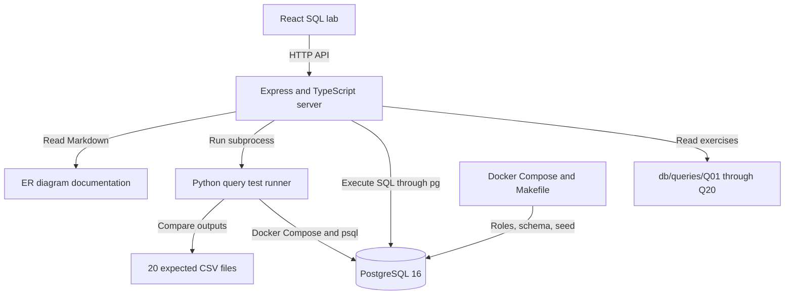

# Repository analysis: Disaster Relief Logistics Database

> Historical analysis of the initial checkout. The later ReliefDB UI/demo work completes Q01–Q20 and adds browser PostgreSQL execution; see `docs/review-demo.md` for the current presentation workflow.

Inspected on 12 October 2026. Repository: `Parth2024P/supplychain_project`, branch `main`, revision `46a23c7ef895b8e40a1ad5f69b2492cfb5ffe69f`.

## What this project is

This is a B.Tech DBMS coursework starter built around disaster-relief logistics in India. It models camps, displaced families, volunteers, donor shipments, supply requests, and inventory. Its main purpose is to teach relational database design, SQL analysis, normalization, transactions, triggers, stored routines, access control, and indexing.

The web application is a SQL exercise viewer and runner. It displays exercise files, executes their SQL, shows query results and timing, reports test status, and renders an entity-relationship diagram. SQL is edited in files on disk; the browser does not provide an editor or normal operational forms for managing camps, stock, or shipments.

The repository is substantially a teaching scaffold: its infrastructure and sample dataset exist, while most assessed SQL work remains to be written.

## How the pieces connect



- **Database:** PostgreSQL 16 Alpine in Docker; database `disaster_relief`; host port 5432.
- **Backend:** Express, TypeScript, `node-postgres`; port 3001. Connection settings accept `PGHOST`, `PGPORT`, `PGUSER`, `PGPASSWORD`, and `PGDATABASE`.
- **Frontend:** React 18, TypeScript, Vite, Mermaid, and Lucide. Vite runs on port 5173 and proxies `/api` to port 3001. The backend can serve a compiled frontend from `ui/client/dist`.
- **Testing:** Python standard library plus Docker's `psql`. Expected results are computed separately in Python from the seed SQL.
- **Supporting material:** Normalization explanations, ER diagram, viva notes, concurrency worksheets, and indexing study worksheets.

## Database model

There are 15 tables:

- Main entities: `relief_camp`, `supply_item`, `donor`, `shipment`, `supply_request`, `volunteer`, and `registered_family`.
- Weak entities with owner-dependent composite keys: `shelter_unit`, `shipment_line`, `request_line`, `volunteer_certification`, and `family_member`.
- Many-to-many association: `assignment` connects volunteers to camps.
- Supporting tables: `camp_stock` stores inventory per camp and item; `request_audit` stores urgency changes.

The schema includes primary keys, foreign keys, identity columns, check constraints, and appropriate examples of cascading and restricted deletion. For example, shipment lines belong to a shipment, and inventory cannot be negative. The schema alone does not automatically update inventory when shipments arrive: that behavior is assigned to an unfinished trigger.

The seed parser found 12 camps, 40 items, 25 donors, 60 volunteers, 90 certifications, 60 assignments, 60 shelter units, 150 families, 568 family members, 120 requests, 299 request lines, 200 shipments, and 666 shipment lines. These are deterministic synthetic examples with deliberate edge cases. Inventory is initialized separately by an aggregate SQL statement.

## What exists and what is unfinished

Implemented infrastructure includes the database schema, deterministic seed SQL, bulk indexing dataset generator, Python reference oracle, query comparison harness, web frontend/backend, and documentation.

Outstanding coursework:

- **20 analytical queries:** every Q01–Q20 file still executes `SELECT 'TODO' AS not_attempted;`.
- **Five triggers:** all are notice-only stubs. They do not install the specified trigger behavior.
- **Four routines:** all return TODO text. For example, `issue_stock()` does not implement the documented three-argument stock deduction function.
- **Seven concurrency scenarios:** instructions exist, but executable session commands remain TODOs.
- **Role permissions:** three `NOLOGIN` roles exist, but detailed grants, revokes, and camp-specific access restrictions are left to the student.
- **Indexing measurements:** executable benchmark queries and suggested indexes exist; measured before/after results remain to be collected.

The exercises cover camp occupancy, shipment totals, unmet demand, donors serving every camp, rankings, expired certifications, missing medical volunteers, running totals, response delays, set operations, views, and materialized views.

## Findings that affect use

1. **The SQL exercises are unfinished by design.** A successful execution of a stub returns a TODO row; it does not demonstrate that the requested analytical feature works.

2. **Database reset does not install triggers or routines.** `make reset` applies only roles, schema, and base seed. After completing the trigger/routine files, they need an explicit installation step.

3. **The API uses the PostgreSQL superuser by default and has no authentication.** CORS is unrestricted, and the server does not explicitly bind to loopback. The API executes SQL files without a read-only transaction or statement timeout. Treat it as a local lab; add authentication, restricted binding, and an appropriate database role before sharing it over a network.

4. **Test infrastructure failures can look like missing attempts in the browser.** `/api/tests/status` returns `success: true` even when its Python subprocess fails. If there are no parsed status lines, the frontend falls back to `NOT ATTEMPTED`.

5. **Multi-statement exercises need backend handling.** View/materialized-view exercises can combine DDL, refresh commands, and a final SELECT. The run endpoint assumes one result object with `fields` and `rows`; node-postgres can return multiple results for multiple statements. That case needs handling before these exercises reliably render in the browser.

6. **The comparison harness is intentionally permissive.** It accepts reordered rows, lowercases text, and rounds numeric values to two decimals. I verified that it accepts `NGO` versus `ngo` and `1.001` versus `1.002`. Passing the harness therefore does not prove exact text, ordering, or high-precision agreement.

7. **Date expectations are fixed.** The Q07 oracle compares certification expiry against `2026-09-30`. A solution using the machine's `CURRENT_DATE` can diverge as time advances. Make the exercise's reference date explicit.

8. **The Makefile assumes a Unix shell and NVM.** `until`, shell conditionals, `sed`, and `~/.nvm` are not a portable native PowerShell workflow. Direct Docker/Python/npm commands are a clearer Windows setup path.

9. **The repository tracks generated dependencies and build output.** It contains 11,126 tracked paths, including both `node_modules` directories, frontend `dist`, and Python bytecode. Downloading these caused large transfers; committed native dependency binaries include Linux-specific packages. Install dependencies from the lockfiles on the target machine and exclude generated folders from future Git commits.

10. **The reset command is destructive and weakly checks SQL errors.** The schema drops existing tables. Its `psql` calls do not set `ON_ERROR_STOP`, so errors can be printed without stopping the overall reset as intended. Use an isolated development database and add fail-fast execution when improving setup.

## Local setup requirements and commands

Python, Node.js, and npm are available in the inspected shell. Docker, Make, and psql were not found on PATH. A running database was therefore not available for SQL integration testing.

After installing and starting Docker Desktop with Compose, the following PowerShell commands provide a manual alternative to Make. The schema command drops the project database's existing tables; use it only on the intended disposable lab database.

```powershell
docker compose up -d
# Wait until this command reports that PostgreSQL accepts connections:
docker compose exec -T db pg_isready -U postgres -d disaster_relief

docker compose exec -T db psql -U postgres -d disaster_relief -v ON_ERROR_STOP=1 -f /db/00_roles.sql
docker compose exec -T db psql -U postgres -d disaster_relief -v ON_ERROR_STOP=1 -f /db/01_schema.sql
docker compose exec -T db psql -U postgres -d disaster_relief -v ON_ERROR_STOP=1 -f /db/02_seed.sql
python tests/runner.py
```

Build the frontend:

```powershell
cd ui/client
npm ci
npm run build
```

Start the backend from a separate terminal:

```powershell
cd ui/server
npm ci
npm start
```

Then open `http://localhost:3001`. Alternatively, run `npm run dev` from `ui/client` for frontend development on port 5173 while the backend runs separately. The backend's test-status command currently invokes `python3`; verify that this command resolves on Windows or change it to the installed Python launcher.

Do not load the million-row bulk seed into the reference-test database unless you plan to reset it afterward: those extra rows change the analytical answers.

## What was verified

- Checked out `main` at the revision listed above, with upstream `origin/main` configured.
- Used a shallow partial clone and sparse checkout to retrieve all application source, SQL, documentation, and tests while excluding `ui/client/node_modules`, `ui/server/node_modules`, `ui/client/dist`, and `scripts/__pycache__`.
- Parsed all six project Python source files successfully.
- Recomputed all 20 reference outputs in memory and confirmed exact agreement with the committed CSVs. No reference files were overwritten.
- Confirmed all 20 SQL exercise files remain placeholders.
- Inspected the frontend/API/database/test relationships and demonstrated the test comparator's case/precision behavior.
- Did not execute SQL against PostgreSQL, install npm dependencies, or claim a successful frontend build; Docker is missing and generated dependencies were deliberately excluded.

## Suggested order of work

First get Docker and the base seed running, then implement Q01–Q20 against the deterministic reference dataset. Next implement and install triggers/routines with meaningful integration checks. Finish role permissions, the two-session transaction demonstrations, and measured index experiments. For a coursework submission, those completed SQL artifacts and observations matter more than adding more frontend screens.
