# Entity-Relationship (ER) Architecture & Modelling

**Course Project:** Disaster Relief Logistics DB  
**DBMS:** PostgreSQL 16  
**Audience:** B.Tech Computer Science & Engineering (DBMS Viva & Lab Examination)  

---

## 1. Relational ER Diagram (Mermaid)

The diagram below documents the authoritative schema.
- **Strong Entities** possess independent existence and identity.
- **Weak Entities** depend existence-wise and identification-wise on their parent entity via composite keys `(owner_id, discriminator_no)`. Identifying relationships are rendered as solid lines (`--||--|{`), cascading on owner deletion.
- **Associative Entity** (`assignment`) implements the many-to-many relationship between `volunteer` and `relief_camp`.
- **Supporting Relations** (`camp_stock` and `request_audit`) enable procedural triggers and transactional concurrency.

```mermaid
erDiagram
    RELIEF_CAMP ||--|{ SHELTER_UNIT : "identifies (1:N)"
    RELIEF_CAMP ||--o{ REGISTERED_FAMILY : "houses (1:N)"
    RELIEF_CAMP ||--o{ SUPPLY_REQUEST : "initiates (1:N)"
    RELIEF_CAMP ||--o{ SHIPMENT : "receives (1:N)"
    RELIEF_CAMP ||--|{ ASSIGNMENT : "assigned (1:N)"
    RELIEF_CAMP ||--|{ CAMP_STOCK : "stocks (1:N)"

    REGISTERED_FAMILY ||--|{ FAMILY_MEMBER : "identifies (1:N)"

    DONOR ||--o{ SHIPMENT : "dispatches (1:N)"
    SHIPMENT ||--|{ SHIPMENT_LINE : "identifies (1:N)"
    SUPPLY_ITEM ||--o{ SHIPMENT_LINE : "manifests (1:N)"

    SUPPLY_REQUEST ||--|{ REQUEST_LINE : "identifies (1:N)"
    SUPPLY_ITEM ||--o{ REQUEST_LINE : "specifies (1:N)"
    SUPPLY_REQUEST ||--o{ REQUEST_AUDIT : "audits (1:N)"

    VOLUNTEER ||--|{ VOLUNTEER_CERTIFICATION : "identifies (1:N)"
    VOLUNTEER ||--|{ ASSIGNMENT : "serves (1:N)"

    SUPPLY_ITEM ||--|{ CAMP_STOCK : "categorizes (1:N)"

    RELIEF_CAMP {
        int camp_id PK "Identity"
        string camp_name "NOT NULL"
        string district "NOT NULL"
        int capacity "CHECK > 0"
        string status "active | full | closed"
    }

    SHELTER_UNIT {
        int camp_id PK,FK "Owner parent"
        int unit_no PK "Discriminator"
        string unit_type "tent | hall | prefab"
        int unit_capacity "CHECK > 0"
    }

    SUPPLY_ITEM {
        int item_id PK "Identity"
        string item_name UK "UNIQUE, NOT NULL"
        string category "food | water | medical | shelter | clothing | hygiene"
        string unit "NOT NULL"
    }

    DONOR {
        int donor_id PK "Identity"
        string donor_name "NOT NULL"
        string donor_type "individual | ngo | corporate | government"
        string phone
    }

    SHIPMENT {
        int shipment_id PK "Identity"
        date shipment_date "NOT NULL"
        string vehicle_no
        string status "dispatched | in_transit | delivered | cancelled"
        int donor_id FK "RESTRICT"
        int camp_id FK "RESTRICT"
    }

    SHIPMENT_LINE {
        int shipment_id PK,FK "Owner parent (CASCADE)"
        int line_no PK "Discriminator"
        int item_id FK "RESTRICT"
        int quantity_sent "CHECK > 0"
    }

    SUPPLY_REQUEST {
        int request_id PK "Identity"
        date request_date "NOT NULL"
        string urgency "low | medium | high | critical"
        int camp_id FK "RESTRICT"
    }

    REQUEST_LINE {
        int request_id PK,FK "Owner parent (CASCADE)"
        int line_no PK "Discriminator"
        int item_id FK "RESTRICT"
        int qty_requested "CHECK > 0"
    }

    VOLUNTEER {
        int volunteer_id PK "Identity"
        string volunteer_name "NOT NULL"
        string phone
        string skill "NOT NULL"
    }

    VOLUNTEER_CERTIFICATION {
        int volunteer_id PK,FK "Owner parent (CASCADE)"
        int cert_no PK "Discriminator"
        string cert_name "NOT NULL"
        string issued_by
        date expiry_date
    }

    REGISTERED_FAMILY {
        int family_id PK "Identity"
        string head_name "NOT NULL"
        string origin_village
        date registered_on "NOT NULL"
        int camp_id FK "RESTRICT"
    }

    FAMILY_MEMBER {
        int family_id PK,FK "Owner parent (CASCADE)"
        int member_no PK "Discriminator"
        string member_name "NOT NULL"
        int age "CHECK 0-120"
        string special_need "NULLABLE"
    }

    ASSIGNMENT {
        int volunteer_id PK,FK "RESTRICT"
        int camp_id PK,FK "RESTRICT"
        string role "NOT NULL"
        string shift "morning | evening | night"
    }

    CAMP_STOCK {
        int camp_id PK,FK "RESTRICT"
        int item_id PK,FK "RESTRICT"
        int quantity_on_hand "CHECK >= 0"
    }

    REQUEST_AUDIT {
        int audit_id PK "Identity"
        int request_id FK "CASCADE"
        string old_urgency
        string new_urgency
        timestamp changed_at "DEFAULT now()"
    }
```

---

## 2. Weak Entities & Identifying Relationships (Viva Explanation)

In relational database theory (Chen / Crow's Foot ER modelling):
1. **Strong Entity:** An entity that possesses sufficient attributes to form a primary key by itself (e.g., `relief_camp`, `volunteer`, `donor`).
2. **Weak Entity:** An entity that cannot be uniquely identified by its own attributes alone. It depends on an **identifying owner entity**. Its primary key is composite, formed by combining:
   - The primary key of the owner entity (`owner_id`), and
   - A local partial key / discriminator (`line_no`, `unit_no`, `cert_no`, `member_no`), which starts at 1 for each owner with no gaps.
3. **Identifying Relationship:** The relationship linking the weak entity to its owner. In the schema, this relationship is implemented using:
   - Composite Primary Key: `PRIMARY KEY (owner_id, discriminator_no)`
   - Referential Action: `ON DELETE CASCADE`. If the owner entity is removed, all dependent weak entity records are automatically purged, preventing orphaned weak entities.

### Summary of Weak Entities in Our Database:
| Weak Entity | Owner Entity | Primary Key | Local Discriminator | Cascade Behavior |
|---|---|---|---|---|
| `shelter_unit` | `relief_camp` | `(camp_id, unit_no)` | `unit_no` (1, 2, 3...) | Deleting a camp purges its units |
| `shipment_line` | `shipment` | `(shipment_id, line_no)` | `line_no` (1, 2, 3...) | Deleting a shipment purges its manifest lines |
| `request_line` | `supply_request` | `(request_id, line_no)` | `line_no` (1, 2, 3...) | Deleting a request purges its item lines |
| `volunteer_certification` | `volunteer` | `(volunteer_id, cert_no)` | `cert_no` (1, 2, 3...) | Deleting a volunteer purges cert credentials |
| `family_member` | `registered_family` | `(family_id, member_no)` | `member_no` (1, 2, 3...) | Deleting a family purges individual member records |

---

## 3. Associative & Supporting Entities

1. **`assignment` (Associative Entity for M:N Relationship):**
   - Resolves the Many-to-Many cardinality between `volunteer` and `relief_camp`.
   - Primary key is the composite key `(volunteer_id, camp_id)`.
   - Stores relationship-specific descriptive attributes: `role` and `shift`.

2. **`camp_stock` (Inventory Balances):**
   - Relational junction tracking the current balance of each supply item at each camp.
   - Primary key: `(camp_id, item_id)`.
   - Maintained consistently through transactional delivery triggers (`T01`) and stock-issue routines (`F01`).

3. **`request_audit` (Temporal Audit Trail):**
   - Captures lifecycle changes in supply request urgency (`low` $\rightarrow$ `medium` $\rightarrow$ `high` $\rightarrow$ `critical`).
   - Recorded automatically by trigger `T04`.
